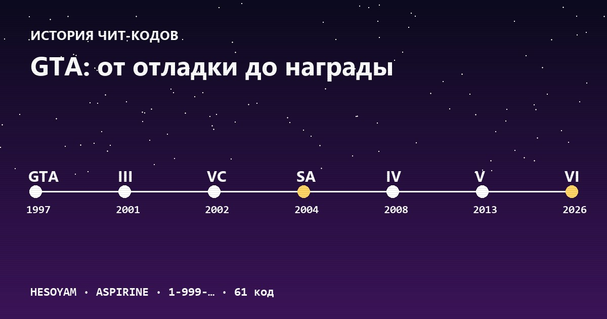
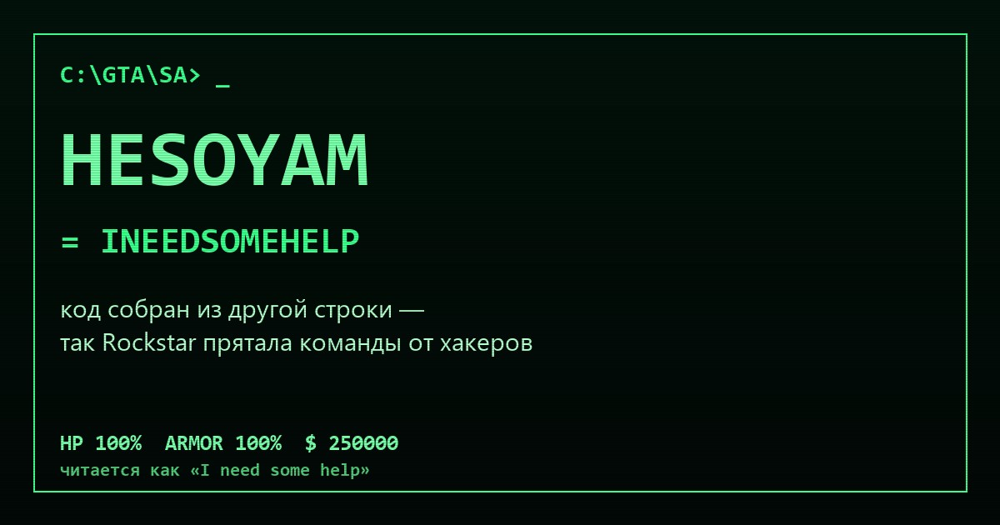
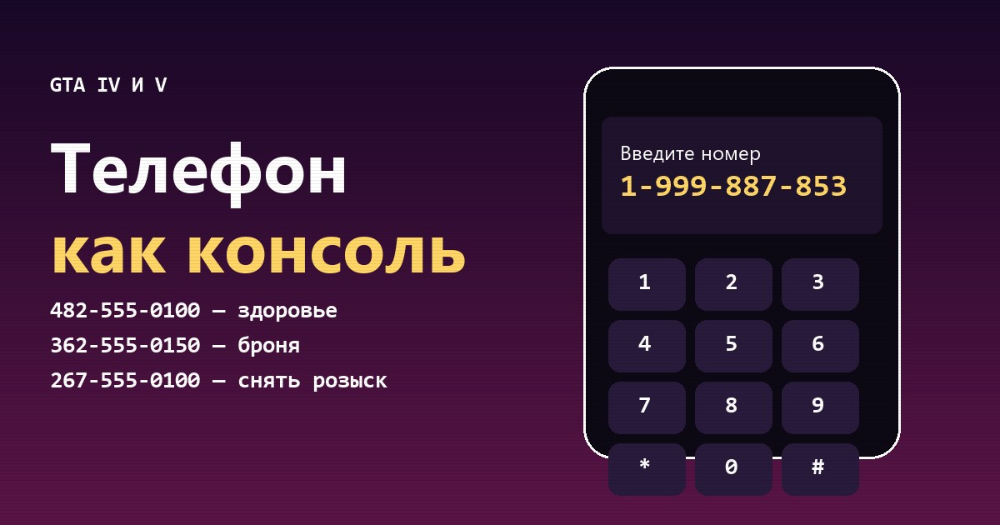

В GTA 6 нашли **61 чит-код** — и это, пожалуй, самый неожиданный поворот в истории серии. Потому что коды не просто вернулись: их превратили в награду. Открываются только после прохождения сюжетной кампании из 91 миссии и выполнения испытаний, а при активации отключают сохранение.

Чтобы понять, как Rockstar дошла до такого решения, нужно отмотать тридцать лет назад — к тому моменту, когда чит-кодов не должно было быть в игре вообще.

## Что такое чит-код на самом деле

Вопреки названию, это не «взлом» и не отдельная программа. Чит-код в GTA — это **консольная команда игрового движка**, которую разработчики оставили в финальной версии. Изначально такие команды нужны им самим: быстро проверить миссию, телепортироваться в точку, выдать оружие, отключить полицию, посмотреть, как ведёт себя транспорт.

Обычно перед релизом этот слой вычищают. Rockstar его оставляла — сначала как пасхалку, потом как традицию. Именно поэтому коды вводятся «странно»: словами, номерами телефонов или последовательностями кнопок. Это не интерфейс для игрока, а обёртка над отладочной консолью, замаскированная под что-то привычное.

## Как коды попадали к игрокам

До массового интернета работал самиздат: журналы с постерами, вкладыши в дисках, тетради, куда переписывали комбинации от друзей. Потом появились базы вроде CheMax, форумы и вики. Каждая новая часть выходила — и через день-два списки уже лежали на десятках сайтов.

Из-за этого вокруг кодов вырос фольклор. «HESOYAM» знали наизусть те, кто даже не помнил, откуда он взялся. А взялся он из другой строки — и это отдельная история.

## GTA III и Vice City: эпоха слов

В третьей части и «Вайс-Сити» коды вводились как слова. Их набирали прямо в игре, и работали они по принципу «если знаешь слово — получишь эффект».

Самые известные из Vice City:

- **ASPIRINE** — здоровье до максимума;
- **PANZER** — танк рядом с игроком;
- **NUTTERTOOLS** — тяжёлое оружие;
- **BIGBANG** — взорвать все машины вокруг.

Просто? Да. Но именно тогда коды стали частью культуры: их вписывали в блокноты, публиковали в журналах, обсуждали в школе. И именно тогда Rockstar начала прятать команды от «читаков» с помощью шифрования строк — чтобы коды не вытащили из исполняемого файла простым поиском.

## San Andreas: золотая эпоха и загадка HESOYAM

Четвёртый по счёту, но, возможно, главный герой этой истории. San Andreas вышла в 2004 году с сотней кодов — на здоровье, оружие, розыск, транспорт, погоду, поведение пешеходов и десяток абсурдных эффектов вроде летающих машин.

Именно здесь появилась легенда о том, откуда берутся «бессмысленные» слова. Разбор кода показал: **HESOYAM** — это альтернативная версия строки **INEEDSOMEHELP** («мне нужна помощь»). Ещё один пример из той же коллекции: **HDLMAAXOPK** расшифровывается как **ILOVESCOTLAND**.

Зачем так? Чтобы команды не находились поиском по тексту. Разработчики не только прятали отладочные вызовы, но и переставляли буквы, меняли строки местами и маскировали названия. Из-за этого часть кодов в разных версиях игры работала по-разному, а фанатские списки десятилетиями расходились между собой.

Несколько кодов, которые знают почти все, кто играл на PC:

| Код | Что делает |
|---|---|
| HESOYAM | здоровье, броня и 250 000 долларов |
| BAGUVIX | неуязвимость |
| AEZAKMI | никогда не искать полицией |
| FULLCLIP | бесконечные патроны |
| UZUMYMW | полный набор тяжёлого оружия |
| ROCKETMAN | реактивный ранец |
| KANGAROO | огромный прыжок |

**Важно:** списки кодов отличаются между PC, PS2 и Xbox, а также между оригиналом и переизданиями. Если код не срабатывает — почти наверняка дело в версии, а не в вас.

## GTA IV: телефон вместо консоли

В 2008-м Rockstar отказалась от слов и сделала ход, который до сих пор называют самым изящным решением серии: коды стали **номерами телефонов**. Внутриигровой мобильник Нико — это буквально интерфейс к отладочным командам.

Часть номеров, которые работали в GTA IV:

- **482-555-0100** — здоровье и оружие;
- **362-555-0150** — здоровье и броня;
- **267-555-0100** — снять розыск;
- **486-555-0100** — продвинутый набор оружия;
- **948-555-0100** — показать, какая песня играет по радио.

Почему это было остроумно: номер телефона не выглядит читом. Его можно «набрать» в игре, не выходя из роли, — и мир не ломается, а реагирует. Заодно Rockstar избавилась от проблемы «случайно ввёл код во время перестрелки».

## GTA V: два языка кодов сразу

Пятая часть объединила оба подхода. На консолях работали последовательности кнопок, на PC и телефоне — номера, начинавшиеся с **1-999-**. Вторая половина номера кодировала слово: 1-999-887-853 — это TURTLE, 1-999-724-654-5537 — PAIN-KILLER.

Примеры:

- **1-999-887-853** (TURTLE) — здоровье и броня до максимума;
- **1-999-724-654-5537** (PAIN-KILLER) — неуязвимость на пять минут;
- **1-999-289-9633** (BUZZOFF) — вертолёт рядом;
- **1-999-332-3393** (BANDIT) — снять розыск.

А вот на консолях нужно было набирать комбинации вроде «вверх, вправо, вниз…». Это неудобно ровно настолько, насколько звучит: половина игроков держала список открытым на телефоне и вводила медленно, боясь сбиться.

Именно в GTA V появилась привычная сейчас граница: коды есть в одиночной игре, но в GTA Online они не работают, а попытки вмешаться в онлайн заканчиваются баном. Это стало началом конца «больших чит-листов» в прежнем виде.

## GTA 6: 61 код, но только после титров

И вот ноябрь 2026-го. В GTA 6 обнаружили **61 чит**, разбитый на пять категорий: игрок, оружие, транспорт, мир, визуальные эффекты. Но просто ввести комбинацию уже не получится.

Условия такие:

1. Пройти основную историю Джейсона и Люсии — 91 миссию.
2. Выполнить испытание под конкретный код: скрываться от полиции, тренироваться, искать коллекционные предметы, брать медали на стрельбище.
3. Активировать: открыть телефон стрелкой вверх, зажать **L1** и нажать **R1** (на Xbox — **LB + RB**), затем ввести последовательность.

И ещё один нюанс, о котором стоит знать заранее: **использование читов отключает сохранение**. Чтобы вернуться к обычному прохождению, нужно выйти из игры и загрузить последнее сохранение.

Несколько кодов, о которых уже пишут игроки:

| Эффект | Комбинация | Условие |
|---|---|---|
| 250 000 долларов | ↑ → ↓ ← ↑ ← ↓ → | пройти сюжет |
| Броня | ↓ ↑ ← ↑ ↑ ↑ ↑ ↑ ↓ ↓ | 100 тренировок |
| Бесконечные патроны | ↓ ↑ → ↓ ← ← ↑ ↓ ↓ ↓ | 25 серебряных медалей на стрельбище |
| Стрельба без перезарядки | ↓ ↑ → ↓ ← ← ↑ ↓ ↓ ↑ | 25 золотых медалей |
| Смена погоды | ↓ → ↑ ↓ → ↑ → | пройти сюжет |
| Взрывающиеся мячи | ↓ ↑ ← ← → ↓ ↓ ↑ → | 20 противников взрывчаткой |

Коды могут меняться с патчами, а часть условий ещё уточняется сообществом — проверяйте на своей версии игры.

## Почему читы почти исчезли из больших игр

Причин три, и все финансовые.

**Онлайн важнее одиночной кампании.** В GTA Online читы ломают экономику: если можно выдать себе деньги и технику, никто не покупает их за реальные. Поэтому сначала коды урезали в онлайне, потом — в целом.

**Достижения и рейтинги.** Код, который даёт бессмертие, обесценивает трофеи. Разработчики либо блокируют ачивки при использовании читов, либо запрещают сохранение — как в GTA 6.

**Античит.** Современные игры защищают память процесса и подписывают файлы. Классический «чит-код» — это дыра в защите, легализованная разработчиком.

GTA 6 показывает компромисс: читы не вырезали, но поставили за финальные титры. Это честно по отношению к тем, кто прошёл игру, и безвредно для онлайна.

## Осторожно: «читы» в интернете — это часто малварь

Отдельная и очень неприятная часть истории. Под видом установщиков GTA 6 и «читерских программ» распространяют вредоносное ПО: крадут пароли, шифруют файлы, майнят на вашем компьютере.

Правила простые:

1. **Официальные чит-коды** вводятся внутри игры. Ничего скачивать не нужно.
2. **Трейнеры и моды** — только из проверенных сообществ и только для одиночной игры, на свой риск.
3. **В GTA Online** любые сторонние программы — прямой путь к бану аккаунта.
4. Если сайт просит «отключить антивирус перед установкой чита» — закрывайте сайт.

## Что осталось от эпохи кодов

Коды перестали быть способом «сломать игру» и стали частью её памяти. HESOYAM знают те, кто играл в 2004-м, — и это слово до сих пор работает как пароль поколения. Телефонные номера GTA IV — пример дизайна, который обсуждают на лекциях по геймдизайну.

GTA 6 сделала следующий шаг: превратила чит в награду. И это, пожалуй, лучший финал для тридцатилетней традиции — вместо того чтобы удалить, её встроили в прогрессию.

## Эпоха за эпохой

| Игра | Как вводили | Сколько | Особенность |
|---|---|---|---|
| GTA III (2001) | слова | десятки | начало традиции |
| Vice City (2002) | слова | ~100 | ASPIRINE, PANZER |
| San Andreas (2004) | слова | ~100 | зашифрованные строки, HESOYAM |
| GTA IV (2008) | телефон | десятки | коды как номера |
| GTA V (2013) | телефон и кнопки | десятки | 1-999-… и комбинации |
| GTA VI (2026) | кнопки, после сюжета | 61 | награда за прохождение |

## Итог

Чит-коды GTA прошли путь от отладочного инструмента до культурного мема и обратно — к осознанной механике. Если вы играете в GTA 6, читы вас ждут, но только после финала. Если вспоминаете старые части — HESOYAM, ASPIRINE и номера из GTA IV никуда не делись, они просто живут в другой эпохе.

**Проверьте перед публикацией:** коды GTA 6 уточняются после патчей, а условия разблокировки части из них сообщество ещё выясняет.

## Источники

- [Hi-Tech Mail — 61 чит в GTA 6 и условия разблокировки](https://hi-tech.mail.ru/news/160998-v-gta-6-chity-otkryvayutsya-posle-zaversheniya-osnovnoi-istorii/)
- [Playground — встроенные читы в GTA 6: как разблокировать](https://www.playground.ru/gta_6/guide/vstroennye_chity_v_gta_6_kak_razblokirovat_chit_kody_i_ispolzovat_v_igre-1891800)
- [GRYOnline — как появилось HESOYAM и почему коды прятали](https://www.gry-online.pl/newsroom/kody-do-gta-san-andreas-vice-city-i-trojki-zostaly-sprytnie-ukryt/zf2b90b)
- [Playground — полный список кодов GTA IV](https://www.playground.ru/gta_4/cheat/grand_theft_auto_gta_iv_4_vse_kody_pc-761177)
- [Cybersport — чит-коды GTA V](https://www.cybersport.ru/blog/games/303376)
- [Onliner — история читерства в видеоиграх](https://tech.onliner.by/2021/12/08/istoriya-chiterstva-v-videoigrax)
